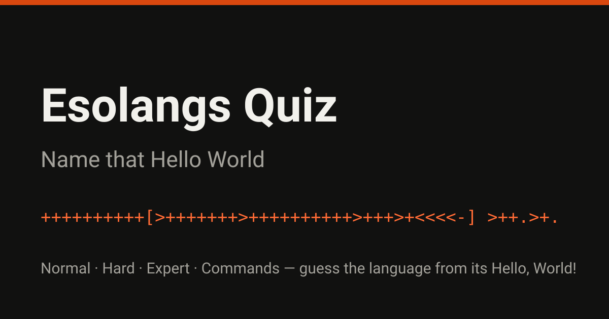

# Esolangs Quiz



**Name that Hello World** — guess the esoteric programming language from its
"Hello, World!" program.

Play it live: **https://bangyen.github.io/esolangs-quiz/**

No timer, no typing — every round is tap/click only (keys 1–8 work on a
keyboard). Answers give one short line of feedback; in Hard and Expert the
explanatory fact about each language is saved for the results review, so a
fact from one round can't help with a later one.

## Modes

| Mode | Rounds per run | Pools (size → drawn) | Options | Hints | Scoring |
| --- | --- | --- | --- | --- | --- |
| Normal | 12 | Questions 20 → 12 | 4 | Free, unlimited | 1 point per correct answer |
| Hard | 15 | Fragments 18 → 6 · Reverse 8 → 3 · Wide 9 → 6 | 4 (fragments, reverse) · 8 (wide) | 1 per run, −25 pts and your streak | +100 per correct answer |
| Expert | 15 | Identification 18 → 6 · Odd-one-out 8 → 3 · Two-stage 10 → 3 · Pairing 10 → 3 | 8 (identification) | None | +100 correct · −50 wrong |

- **Normal** — famous esolangs (Brainfuck, LOLCODE, Shakespeare, Chef, …),
  full programs, plain name-only options.
- **Hard** — the telltales are cut: fragments are a 1–2 line middle excerpt
  (no `HAI`, no recipe header, no `IT'S SHOWTIME`), and every option comes
  from the same close family. Reverse rounds name a language and offer four
  genuine candidates from other languages in its family. Wide rounds offer
  8 options, including Piet as an actual program image and raw, invisible
  Whitespace.
- **Expert** — a deep pool of obscure languages (Thue, FALSE, SNUSP,
  Brainbool, Smallfuck, `///`, Underload, Iota, Jot, Lazy K, …), plus
  odd-one-out rounds (four snippets, one not of the family), two-stage
  rounds (commit to a family first — wrong family ends the round — then
  the exact language), and pairing rounds (two excerpts: same language,
  yes or no?).

## How the draws work

Every pool is larger than the number of rounds it serves. Each run draws
its rounds at random from the pool, preferring entries the previous run
of that phase did not serve, and Hard/Expert additionally avoid repeating
a language across phases within a run where the pools allow it — so a
replay is a genuinely different set of questions, not the same fixed set
reshuffled.

## Building and testing

The site is a single self-contained `index.html` at the repo root, which
is what GitHub Pages serves (legacy publishing from `main`). That file is
**generated** — edit the sources, not the output:

```
src/shell.html    page shell (tokens are replaced at build time)
src/style.css     the stylesheet
src/quiz.js       game logic
src/data/*.json   the question pools (normal / hard / expert)
scripts/build.py  zero-dependency build (Python 3 standard library)
assets/           the Piet program image, favicon, and social image
```

```sh
python3 scripts/build.py            # rebuild index.html from src/
python3 scripts/build.py --check    # fail if index.html is stale
python3 -m unittest discover -s tests
```

The tests pin the pool invariants (unique option sets containing the
answer exactly once, fragments ≤ 2 lines, exactly one matching reverse
candidate, two-stage languages in their declared families, an evenly
split pairing pool, pool sizes ≥ draw counts read out of `buildOrder()`)
and check that the built page is fresh and its script parses. CI runs
both on every push and pull request to `main`.

To play a local build, open `index.html` in a browser or serve the repo
root, e.g. `python3 -m http.server`.

## License

MIT — see [LICENSE](LICENSE).
